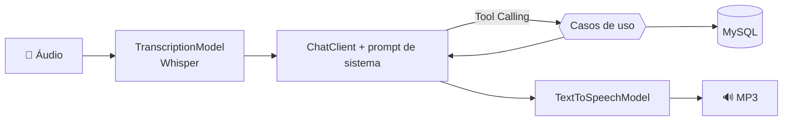

# 💰 Budgeting AI: assistente financeiro por voz com Spring AI

Projeto do desafio **API Inteligente com Spring AI** (DIO). Parti do projeto final do módulo
[05-spring-ai](https://github.com/digitalinnovationone/dio-spring-boot-learning-track/tree/main/05-spring-ai)
e o evoluí com novas consultas financeiras, validações de negócio, melhor tratamento de erros, mais testes e documentação.

## 📌 O que o projeto faz

É uma API de orçamento pessoal que entende **comandos de voz**. A pessoa grava algo como
*"Gastei 80 reais no mercado"* ou *"Quanto eu gastei com farmácia?"* e a API:

1. recebe o **áudio**;
2. transforma o áudio em **texto** (Speech-to-Text);
3. usa um **modelo de linguagem** para entender a intenção;
4. executa uma **função real** da aplicação (Tool Calling), que cria ou consulta transações;
5. gera uma **resposta em texto** e a converte em **áudio** (Text-to-Speech).



### Arquitetura em camadas (mantida da base)

```
src/main/java/dio/budgeting
├── domain/           regras de negócio e contrato do repositório (sem Spring)
├── application/      casos de uso, usados pelo REST e também como @Tool da IA
└── infrastructure/
    ├── ai/           BudgetAssistant: ChatClient + prompt + ferramentas
    ├── http/         controller, DTOs e tratamento de erros
    └── persistence/  JPA (entidade e adaptador do repositório)
```

A regra de ouro do projeto: **a IA nunca fala direto com o banco**. Ela só chama casos de uso, e por isso passa
pelas mesmas validações do domínio que a API REST.

## 🚀 Melhoria implementada

Escolhi uma evolução focada em **novas ferramentas para o Tool Calling**, **validações antes de salvar** e **testes**:

| # | Melhoria | Onde |
|---|----------|------|
| 1 | **Nova consulta "quanto gastei?"**: total e detalhamento por categoria, geral ou filtrado | `GetSpendingSummaryUseCase` (ferramenta `get-spending-summary` + `GET /transactions/summary`) |
| 2 | **Nova consulta "últimos gastos"** (padrão 5, máximo 20) | `ListLatestTransactionsUseCase` (ferramenta `list-latest-transactions` + `GET /transactions/latest`) |
| 3 | **Validações de negócio** antes de salvar: descrição obrigatória (até 120 caracteres), valor maior que zero e até R$ 100.000,00, categoria obrigatória | `Transaction` + `InvalidTransactionException` |
| 4 | **Erros padronizados** (RFC 7807): 422 para regra de negócio, 400 para categoria inválida | `ApiExceptionHandler` |
| 5 | **Respostas de IA melhores**: novo prompt de sistema (regras de categoria, centavos, pedir dado faltante, resposta curta para áudio) | `prompts/system-message.st` |
| 6 | **Novas categorias**: `FOOD`, `TRANSPORT`, `LEISURE`, `OTHER` | `Category` |
| 7 | **Data de criação** da transação (necessária para "últimos gastos") | `Transaction.createdAt` |
| 8 | **Endpoint de IA por texto** `POST /transactions/ai/text`, para testar o assistente sem gravar áudio | `TransactionController` |
| 9 | **`BudgetAssistant`** isola o ChatClient e o prompt, deixando o controller mais simples | `infrastructure/ai` |
| 10 | **Testes sem OpenAI e sem MySQL** para os principais fluxos | `src/test` |

### Duas correções que encontrei ao revisar a base

- **Centavos x reais:** o valor é guardado em centavos, mas `TransactionOutput` não dividia por 100
  (8000 centavos saía como `8000.00`). Agora a conversão é feita por `Money.fromCents` (8000 → `80.0`).
  Isso importa porque a resposta falada usa esse número.
- **Encoding do prompt:** o prompt era lido com `Charset.defaultCharset()`, que pode corromper acentos no Windows.
  Agora é lido sempre em UTF-8.

## 🛠️ Tecnologias

- Java (toolchain 25, como na base) e **Spring Boot 4.0.5**
- **Spring AI 2.0.0-M4**: `ChatClient`, Tool Calling (`@Tool`/`@ToolParam`), `TranscriptionModel`, `TextToSpeechModel`
- **OpenAI**: `gpt-4o-mini` (chat), `whisper-1` (áudio → texto), `gpt-4o-mini-tts` (texto → áudio)
- Spring Web, Spring Data JPA, **MySQL 9.6** (via Docker Compose)
- Gradle, Lombok
- Testes: JUnit 5, Mockito, AssertJ, MockMvc e H2 (só nos testes)

## ▶️ Como executar

**Pré-requisitos:** JDK compatível com o toolchain do `build.gradle` (25; o Spring Boot 4 roda a partir do Java 17,
então se você usa outro JDK, ajuste `languageVersion`), Docker e uma [chave da OpenAI](https://platform.openai.com/api-keys).

```bash
export OPENAI_API_KEY="sua_chave_aqui"     # Windows (PowerShell): $env:OPENAI_API_KEY="sua_chave_aqui"
./gradlew bootRun
```

O `spring-boot-docker-compose` sobe o MySQL automaticamente a partir do `compose.yml`. A API fica em `http://localhost:8080`.

> ⚠️ O uso dos modelos da OpenAI é **pago**. Nunca coloque a chave no código ou no GitHub.

## 🧪 Como testar o fluxo principal

### Opção 1: por texto (mais rápido e barato)

```bash
# Registrar um gasto
curl -X POST localhost:8080/transactions/ai/text \
  -H 'Content-Type: application/json' \
  -d '{"message":"Gastei 45 reais e 90 centavos na farmácia comprando remédio"}'

# Consultar
curl -X POST localhost:8080/transactions/ai/text \
  -H 'Content-Type: application/json' \
  -d '{"message":"Quanto eu já gastei no total?"}'
```

Formato da resposta (o texto exato varia a cada execução do modelo):

```json
{ "answer": "Registrei quarenta e cinco reais e noventa centavos em farmácia." }
```

### Opção 2: por voz (fluxo completo)

Use um dos áudios de exemplo que já vêm no projeto:

```bash
curl -X POST localhost:8080/transactions/ai \
  -F "file=@src/test/resources/audio/recording-1.m4a" \
  --output resposta.mp3
```

Abra o `resposta.mp3` para ouvir a resposta do assistente. Você também pode gravar o seu próprio áudio.

### Opção 3: pela API REST (sem IA)

```bash
curl -X POST localhost:8080/transactions -H 'Content-Type: application/json' \
  -d '{"description":"Compras no mercado","category":"GROCERIES","amount":8000}'

curl localhost:8080/transactions/summary
curl "localhost:8080/transactions/summary?category=GROCERIES"
curl "localhost:8080/transactions/latest?limit=3"
```

O arquivo [`requests.http`](requests.http) tem todas essas chamadas prontas (IntelliJ ou VS Code).

### Validação em ação

```bash
curl -X POST localhost:8080/transactions -H 'Content-Type: application/json' \
  -d '{"description":"Mercado","category":"GROCERIES","amount":0}'
```

```json
{
  "type": "about:blank",
  "title": "Transação inválida",
  "status": 422,
  "detail": "O valor da transação deve ser maior que zero."
}
```

Se a validação falhar quando o pedido vem **por voz**, o erro volta para o modelo como resultado da ferramenta e o
assistente explica o motivo para a pessoa, falando.

## 📡 Endpoints

| Método | Rota | Descrição |
|--------|------|-----------|
| POST | `/transactions` | Cria uma transação (`amount` em **centavos**) |
| GET | `/transactions/{category}` | Lista por categoria |
| GET | `/transactions/summary?category=` | **Novo:** total e detalhamento por categoria |
| GET | `/transactions/latest?limit=` | **Novo:** últimas transações |
| POST | `/transactions/ai` | Assistente por **voz** (multipart `file` → `audio/mp3`) |
| POST | `/transactions/ai/text` | **Novo:** assistente por **texto** (JSON → JSON) |

Categorias: `GROCERIES`, `PHARMA`, `AUTO`, `FOOD`, `TRANSPORT`, `LEISURE`, `OTHER`.

## ✅ Testes automatizados

```bash
./gradlew test
```

| Teste | O que garante |
|-------|---------------|
| `TransactionTest` | Regras de negócio do domínio (descrição, valor, limite, categoria) |
| `PersistTransactionUseCaseTest` | Salva em reais corretos e **não** salva quando inválido |
| `GetSpendingSummaryUseCaseTest` | Soma e agrupamento por categoria, filtro e caso vazio |
| `ListLatestTransactionsUseCaseTest` | Limite padrão e máximo |
| `MoneyTest` | Conversão de centavos para reais |
| `TransactionControllerTest` | Contrato HTTP, códigos 201/400/422 e o fluxo de voz (áudio → texto → assistente → áudio) com a IA simulada por mocks |
| `BudgetingApplicationTests` | O contexto Spring sobe com todas as ferramentas registradas (H2, sem chamadas externas) |

Os testes `*IT` da base (OpenAI de verdade) continuam existindo e só rodam quando `OPENAI_API_KEY` está definida.

## 📚 O que aprendi

> *(rascunho: reescreva com as suas palavras e inclua prints dos seus testes)*

- **IA é parte da aplicação, não um atalho.** Expor casos de uso como `@Tool` faz o modelo respeitar as mesmas regras
  de negócio que a API REST, e uma validação no domínio protege os dois caminhos de uma vez.
- **A descrição da ferramenta e o prompt de sistema funcionam como contrato.** Detalhes como "o valor é em
  centavos" e "responda em até duas frases" mudam muito a qualidade da resposta falada.
- **Reuso:** a mesma consulta serve o endpoint REST e a IA, sem duplicar lógica.
- **Dá para testar IA sem chamar a IA.** Mockando `TranscriptionModel`, `TextToSpeechModel` e o assistente, testei o
  fluxo inteiro de forma rápida, grátis e determinística.
- **Revisar a base vale a pena:** encontrei o problema de centavos x reais justamente ao ler como a resposta final
  seria falada.

## 🔭 Próximos passos

- Agregar o resumo no banco (`GROUP BY`) em vez de em memória, para volumes grandes.
- Filtros por período ("quanto gastei este mês?") com a data que já é gravada.
- Autenticação e transações por usuário.
- Testes de integração do assistente com respostas gravadas, para não depender de chamadas pagas.

## 🙏 Créditos

Projeto base: [dio-spring-boot-learning-track / 05-spring-ai](https://github.com/digitalinnovationone/dio-spring-boot-learning-track/tree/main/05-spring-ai) (DIO, com o expert Poiani).
